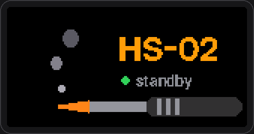

<p align="center"></p>

<p align="center">
  <b>English</b> · <a href="README.ru.md">Русский</a>
</p>

<p align="center">
  <a href="https://github.com/yakory777/HS-02/actions/workflows/build.yml"></a>
  <a href="https://github.com/yakory777/HS-02/releases/latest"></a>
  
  <a href="LICENSE"></a>
</p>

# HS-02 Modern UI

A custom [IronOS](https://github.com/Ralim/IronOS) firmware for the **FNIRSI HS-02A** (C245 tips) and **HS-02B** (C210 tips) smart soldering irons, with a redesigned colour interface in the spirit of iOS: a black screen, a coloured status pill, big readable numbers and a segmented progress bar. Controls, menu layout and the firmware-update entry follow the stock FNIRSI firmware, so it feels familiar from the first minute.

**What you get**

- 🎨 **A new colour UI** for every everyday screen: standby, heating, ready, cooling, sleep, settings, calibration and warnings, drawn with the Inter typeface and two-level anti-aliasing.
- 🕹️ **FNIRSI-style controls**: OK starts heating, +/− change the target (held: accelerating), OK cycles three presets, hold OK to stop or open the settings.
- ⚙️ **Clear settings menu**: Sleep / Tip / System / Advanced, in English or Russian (switchable at any time), with live preview of brightness and sound.
- 🌡️ **3-point tip calibration** (150 / 250 / 350 °C) against a tip thermometer, stored in the stock format, with the factory values kept for a one-click reset.
- 🔊 **Buzzer** with adjustable volume: a chime when the tip is ready, clicks for presets and start/stop.
- 🔌 **USB-PD voltage** selectable (9 / 12 / 15 / 20 V) through the CH224K, like the stock firmware.
- ⬆️ **Firmware update from the menu**, using the same bootloader flag as the stock firmware (no button juggling).
- 🎞️ **Your own GIFs**: a standby screensaver and a boot animation. A web constructor takes a GIF or an MP4, crops it to the screen and puts it into a finished firmware file, no rebuild needed.
- 🛡️ Proper IronOS PID control, thermal-runaway protection, motion sleep and auto power-off underneath.

> [!WARNING]
> This is unofficial firmware for a device that heats to 450 °C. It is provided as-is, without warranty. The FNIRSI bootloader is never touched, so you can always go back to the stock firmware (see [Flashing](#flashing)).

## Screens

Every image below is rendered by the **real firmware drawing code** (see [Screenshots](#regenerating-the-screenshots)), not mocked up.

<table>
  <tr>
    <td align="center"><br><sub><b>Standby</b>: heater off, target and preset on the right</sub></td>
    <td align="center"><br><sub><b>Heating</b>: the bar shows progress to the target</sub></td>
  </tr>
  <tr>
    <td align="center"><br><sub><b>Ready</b>: a chime, and the bar becomes the heater load</sub></td>
    <td align="center"><br><sub><b>Cooling</b>: the target was lowered</sub></td>
  </tr>
  <tr>
    <td align="center"><br><sub><b>Hot!</b>: heater off but the tip is above 50 °C (blinks)</sub></td>
    <td align="center"><br><sub><b>Sleep</b>: holds the sleep temperature until you move the iron</sub></td>
  </tr>
  <tr>
    <td align="center"><br><sub><b>Settings</b>: Sleep / Tip / System / Advanced</sub></td>
    <td align="center"><br><sub><b>Editing a value</b>: the accent capsule</sub></td>
  </tr>
  <tr>
    <td align="center"><br><sub><b>Calibration</b>: enter the thermometer reading</sub></td>
    <td align="center"><br><sub><b>Safety alerts</b>: thermal runaway, low voltage, …</sub></td>
  </tr>
</table>

<p align="center"><br><sub>Boot splash: the segments fill up, then turn green.</sub></p>

## Controls

The HS-02 has three buttons: **+**, **−** and **OK** (the +/− roles can be swapped in *System → +/− buttons*).

| Screen | + / − | OK | Hold OK |
| :-- | :-- | :-- | :-- |
| **Standby** | change the target | start heating | open **Settings** |
| **Soldering** | change the target by the step (held: ×2 after 1 s, ×5 after 2.5 s) | next **preset** (300 → 330 → 360 °C) | stop heating → standby |
| **Sleep** | wake up | wake up | wake up |
| **Settings** | move / change a value | open / edit / confirm | back |
| **Calibration** | adjust the thermometer reading | next point (when stable) | abort |

Holding **+ and −** together in standby also opens the settings, and in soldering mode it stops heating, as on the stock firmware.

## Settings

```
Settings
├── Sleep      Sleep after · Sleep temperature · Power off after · Motion sensor
├── Tip        Preset 1 · Preset 2 · Preset 3 · +/− step · Max power · PD voltage
│              Calibration › · Reset calibration
├── System     Sound · Brightness · Orientation · +/− buttons · Language · GIF screensaver · Boot GIF
│              Firmware update · Factory reset · Version
├── Advanced   All IronOS settings (the original menu) · Diagnostics
└── Exit
```

Defaults: presets 300 / 330 / 360 °C, step 5 °C, sleep after 5 min at 150 °C, sound 5/10, 20 V, GIF screensaver after 30 s. The menu saves and closes itself after 60 s without input.

## Flashing

1. Download the firmware from **[Releases](https://github.com/yakory777/HS-02/releases/latest)**:

   | Your iron | Russian | English |
   | :-- | :-- | :-- |
   | HS-02**A** (C245 tips) | `HS02A_RU.bin` | `HS02A_EN.bin` |
   | HS-02**B** (C210 tips) | `HS02B_RU.bin` | `HS02B_EN.bin` |

   The colour UI picks its language from the build (*System → Language → Auto*) and can be switched between Russian and English at any time; the build language also sets the classic IronOS menu under *Advanced*.

   > Use the file for **your** model: the tip parameters and PID tuning differ (C245: 2.5 Ω, KP 55 / KD 6000; C210: 2.6 Ω, KP 40 / KD 4500), and so does the bootloader header (`bin` on HS-02A, `BIN` on HS-02B).

2. Enter the bootloader, either way:
   - **from the menu**: *Settings → System → Firmware update → OK* (once this firmware is installed), or
   - **manually**: unplug the iron, hold **OK**, plug it into a computer with a USB-C *data* cable, release OK when the screen says `Please drag the firmware file to the USB flash disk!`.
3. A USB drive called **BOOTLOADER** appears. Copy the `.bin` file onto it. You have about 40 s before the bootloader gives up and starts the current firmware.
4. The iron shows `Updating firmware!` and restarts with the new firmware.

> [!TIP]
> On **Linux** the FNIRSI bootloader mishandles write caching: copy the file **twice** with `sync` after each copy, or use `scripts/flash_hs02b_linux.sh <file.bin>`. On Windows, if nothing happens, simply copy the file again.

See also [Going back to the stock firmware](#going-back-to-the-stock-firmware).

## Going back to the stock firmware

The FNIRSI bootloader is never modified, so you can return to the official firmware at any time.

1. **Get the official file** for your model:
   - **HS-02A**: [`Stock bin/APP_HS_02A_V2.1.1_260112.bin`](Stock%20bin/) in this repository (with FNIRSI's original [`README.txt`](Stock%20bin/README.txt)). It is FNIRSI's software (© FNIRSI, all rights reserved), kept here only so you can roll back.
   - **HS-02B** or a newer version: from FNIRSI, via the support / download section of [fnirsi.com](https://www.fnirsi.com) or support@fnirsi.com.
2. **Check it** (optional, recommended): the known HS-02A file is

   | File | Size | SHA-256 |
   | :-- | :-- | :-- |
   | `APP_HS_02A_V2.1.1_260112.bin` (V2.1.1, 2026-07-30) | 71 724 bytes | `b55bfb2dce6776fc0ca9d862250426d1daa26736d6c796b9b961ee5d9eee289f` |

   Windows: `certutil -hashfile APP_HS_02A_V2.1.1_260112.bin SHA256` · Linux/macOS: `sha256sum APP_HS_02A_V2.1.1_260112.bin`
3. **Enter the bootloader**: *Settings → System → Firmware update*, or unplug, hold **OK** and plug in USB.
4. **Copy the official `.bin`** to the **BOOTLOADER** drive (keep its original file name) and wait for the restart.

What survives: IronOS keeps its own settings in a separate flash page, so the stock settings stay as they were. If you used *Tip → Calibration*, run *Tip → Reset calibration* **before** going back to restore the factory calibration values (the stock firmware would otherwise use your calibration, which is also fine).

## Tip calibration

You need a tip thermometer (an FG-100-style meter, or a fine K-type thermocouple with a MAX31855/MAX6675).

1. *Settings → Tip → Calibration*. The iron heats to **150 °C** (by its own reading).
2. When the reading has been stable for 3 s the pill turns **green**. Measure the tip, set the measured value with **+/−** and press **OK**.
3. Repeat for **250 °C** and **350 °C**.
4. The result is written into the stock calibration words (raw ADC counts at 140 / 240 / 340 °C), so the stock firmware uses it too.

Before the first write the factory values are backed up; *Reset calibration* restores them. In a simulation with a deliberately wrong factory calibration (+32 °C at 150 °C), the error after calibration stays within 2–3 °C between 150 and 350 °C.

## Your own GIFs: screensaver and boot animation

<p align="center"><br><sub>The bundled example (<code>custom/standby.gif</code>), as the firmware draws it.</sub></p>

The firmware can show two animations of your own:

- **a standby screensaver**: plays full screen while the iron sits idle. Delay in *Settings → System → GIF screensaver*: Off, 5 s, 15 s, 30 s (default), 1, 2 or 5 min. Any button or moving the iron brings standby back at once, and that press does nothing else, so it can't start heating. It never shows while the tip is above 50 °C, on a tip fault or below 9 V;
- **a boot animation**: plays instead of the boot splash (1.5 to 8 s, a button skips it). Turn it off in *System → Boot GIF*.

**Web constructor** ([`tools/hs02-gif-studio`](tools/hs02-gif-studio/README.md); with GitHub Pages enabled it runs at `https://<user>.github.io/<repo>/`):

1. Pick the model and language (or load your own `.bin` from a release).
2. Load a GIF or a short video (MP4, WebM, MOV) for standby and/or boot. For a video, pick the start, length (up to 20 s) and frames per second; the browser cuts it into frames. Drag the frame to choose the area: *Fit* shows the whole frame with borders, *Fill* crops the edges, *Free* stretches the chosen area. Speed, frame range and border colour are adjustable.
3. The preview shows exactly what the iron will show. Press *Download firmware* and flash it as usual.

No rebuild is needed: the constructor appends the GIFs to a finished `.bin` (up to ~28 KB for both; it drops frames by itself when needed). The screen keeps 4 colours per band of 4 rows (up to 80 colours per frame), so simple artwork with flat colours looks best.

For releases, CI does the same with `custom/standby.gif` and `custom/boot.gif` (if present). From the command line: `node tools/hs02-gif-studio/cli.mjs --firmware HS02A_RU.bin --standby my.gif --boot boot.gif`.

## Building from source

Requirements: `arm-none-eabi-gcc` (with newlib), GNU make, Python 3 with `bdflib`.

```bash
cd source
make model=HS02A firmware-RU -j$(nproc)    # HS02A / HS02B, EN / RU / any Translations/*.json
ls Hexfile/*_firmware.bin                  # this is the file to flash (16-byte bootloader header)
```

- **Windows**: use WSL (Ubuntu): `sudo apt install gcc-arm-none-eabi libnewlib-arm-none-eabi libstdc++-arm-none-eabi-newlib make python3-pip` and `pip install --break-system-packages bdflib`.
- **Docker**: `docker build -f scripts/IronOS.Dockerfile -t ironos . && docker run --rm -v "$PWD":/build/ironos ironos sh -c "cd source && make model=HS02A firmware-RU -j4"`.
- **CI**: every push builds HS02A/HS02B × EN/RU on GitHub Actions; pushing a tag `v*` publishes a release with the four `.bin` files.

Any `Translations/translation_*.json` language can be built for the classic IronOS screens; the colour UI itself ships in English and Russian (*System → Language*, *Auto* = Russian for RU/UK/BE builds, English otherwise).

### Changing texts or fonts

All colour-UI strings live in [`Hs02UiStrings.hpp`](source/Core/Threads/UI/drawing/color_160x80/Hs02UiStrings.hpp), one line per string with the English and Russian text. Only the glyphs actually used are embedded, so after editing text regenerate the font tables:

```bash
pip install pillow
python3 tools/hs02-ui-fonts/gen_modern_font.py
```

### Regenerating the screenshots

```bash
tools/hs02-wasm-preview/render_docs.sh     # needs g++ and Pillow; writes docs/images/
```

There is also an interactive browser preview (WebAssembly, needs Emscripten): see [`tools/hs02-wasm-preview`](tools/hs02-wasm-preview/README.md).

## How it works

<details>
<summary><b>Colour on a 2-bit framebuffer</b></summary>

The ST7735 frame is kept as 2 bits per pixel (3.2 KB of the MCU's 24 KB RAM), i.e. only 4 colours. The screens are laid out in horizontal rows (status pill · value · bar · footer), so the LCD driver gets a palette **per row band** ([`ColorBand.hpp`](source/Core/Drivers/ColorBand.hpp), `LCD::setColorBands`). Each band has its own 4 colours, enough for black, white, grey, the state colour and its tint without extra RAM. Text is Inter rendered at build time to 2-bit glyphs (solid + edge), with the edge painted in a dim colour for cheap anti-aliasing.
</details>

<details>
<summary><b>Firmware update from the menu</b></summary>

Reverse engineering of the stock `APP_HS_02A_V2.1.1` showed that its *Firmware upgrade* item writes `0x87456321` into word 18 of its settings block at `0x0801F800` and resets. The bootloader sees the flag and starts the USB drive. This firmware does the same (`enterFirmwareUpdateMode()` in the Fnirsi BSP), preserving the rest of the block, including the factory calibration.
</details>

<details>
<summary><b>Bootloader header and file name</b></summary>

The MSD bootloader expects a 16-byte header: a 3-letter tag + `\0` + the little-endian image length. The HS-02A bootloader wants a lowercase `bin` (as the official HS-02A files have), the HS-02B fork used `BIN`. The Makefile picks it per model (`FNIRSI_HEADER_TAG`). Short 8.3 file names are the safest choice.
</details>

<details>
<summary><b>Calibration format</b></summary>

The stock block stores three words at offsets `0x16..0x18`: `raw ADC count + bias` for 140 / 240 / 340 °C (biases `0x7F21 / 0x7E77 / 0x7DC4`). The temperature model interpolates through them piecewise-linearly. The calibration screen measures the raw count at three thermometer-verified points (compensating the handle-temperature term the model adds), interpolates the counts at the anchor temperatures and writes them back. A one-time backup of the factory words lives in words 100–102, which stock never uses.
</details>

<details>
<summary><b>USB-PD voltage</b></summary>

The CH224K sink is configured by the MCU through CFG2/CFG3 (PB7/PB6), with CFG1 tied low: `00` 9 V, `01` 12 V, `11` 15 V, `10` 20 V. The setting is applied at boot and when changed; if your charger doesn't renegotiate, replug the cable.
</details>

### Where things are

| Path | What |
| :-- | :-- |
| `source/Core/Threads/UI/drawing/color_160x80/draw_home_gauge.cpp` | all colour screens (gauge, boot, menu, alerts, calibration) |
| `source/Core/Threads/UI/logic/ModernMenu.cpp` | the settings menu (structure, formatting, actions) |
| `source/Core/Threads/UI/logic/TipCalibration.cpp` | the 3-point calibration flow |
| `source/Core/Threads/UI/logic/utils/Hs02Controls.*` | FNIRSI-style +/−, presets, deferred saving |
| `source/Core/BSP/Fnirsi/` | board support: buzzer, PD voltage, bootloader flag, temperature model |
| `source/Core/Drivers/LCD.*`, `ColorBand.hpp` | ST7735 driver with per-row palettes |
| `tools/hs02-ui-fonts/` | font generator (Inter, SIL OFL) |
| `tools/hs02-wasm-preview/` | UI preview + screenshot renderer |
| `tools/hs02-gif-studio/` | the GIF web constructor and its CLI (`custom/`: GIFs for releases) |
| `source/Core/Threads/UI/drawing/color_160x80/draw_gif.cpp` | GIF playback (screensaver: `logic/HomeScreen.cpp`, boot: `BSP/Fnirsi/BSP.cpp`) |

Developer notes (hardware facts, gotchas): [`DEVELOPMENT.md`](DEVELOPMENT.md). Changes: [`CHANGELOG.md`](CHANGELOG.md).

## Roadmap

- Preset chips (300 · 330 · 360) on the main screen, like CH1/CH2/CH3 on stock
- A brief highlight when the target changes
- Larger 12 px footer text; alternating hints in standby; a scroll bar in long menus
- Colour versions of the remaining classic IronOS screens (Advanced, Diagnostics)

## Credits

Built on the shoulders of:

- [**IronOS**](https://github.com/Ralim/IronOS) by Ben V. Brown (Ralim) and contributors: the soldering firmware itself
- [**PanKleszcz/IronOS**](https://github.com/PanKleszcz/IronOS): the original FNIRSI HS-02 port
- [**ok2cm/IronOS**](https://github.com/ok2cm/IronOS): colour 160×80 UI, PID, boot logo, OK button
- [**MYMDO/IronOS-FNIRSI-HS-02B**](https://github.com/MYMDO/IronOS-FNIRSI-HS-02B): HS-02B support, calibration RE, PWM fixes (its original README is kept in [`Documentation/upstream-fork`](Documentation/upstream-fork/README.uk.md))
- [**Inter**](https://github.com/rsms/inter) typeface by Rasmus Andersson (SIL OFL 1.1)

## License

[GNU GPLv3](LICENSE), like IronOS. FreeRTOS, the vendor SDK and the Inter font keep their own licenses ([`tools/hs02-ui-fonts/OFL.txt`](tools/hs02-ui-fonts/OFL.txt)). Not affiliated with FNIRSI.
