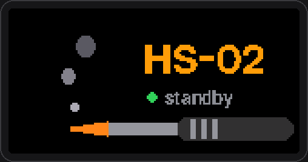

<p align="center"></p>

<p align="center">
  <a href="README.md">English</a> · <b>Русский</b>
</p>

<p align="center">
  <a href="https://github.com/yakory777/HS-02/actions/workflows/build.yml"></a>
  <a href="https://github.com/yakory777/HS-02/releases/latest"></a>
  
  <a href="LICENSE"></a>
</p>

# HS-02 Modern UI

Кастомная прошивка на базе [IronOS](https://github.com/Ralim/IronOS) для умных паяльников **FNIRSI HS-02A** (жала C245) и **HS-02B** (жала C210). Цветной интерфейс в ней полностью перерисован в духе iOS: чёрный экран, цветная «таблетка» статуса, крупные цифры и сегментная шкала. Управление, устройство меню и переход в режим прошивки повторяют официальную прошивку FNIRSI, поэтому всё привычно с первой минуты.

**Что внутри**

- 🎨 **Новый цветной интерфейс** на всех повседневных экранах: ожидание, нагрев, готов, остывание, сон, настройки, калибровка, предупреждения. Шрифт Inter с двухуровневым сглаживанием.
- 🕹️ **Управление как у FNIRSI**:
  - OK включает нагрев;
  - +/− меняют температуру, при удержании ускоряются;
  - OK во время пайки переключает три пресета;
  - удержание OK выключает нагрев или открывает настройки.
- ⚙️ **Понятное меню**: Сон, Жало, Система и Расширенные. Есть русский и английский язык, переключаются в любой момент. Яркость и звук меняются сразу, пока листаешь значения.
- 🌡️ **Калибровка жала по 3 точкам** (150 / 250 / 350 °C) с термометром. Результат сохраняется в заводском формате, а заводские значения можно вернуть одним пунктом.
- 🔊 **Пищалка с регулировкой громкости**: сигнал при выходе на температуру, щелчки при смене пресета, включении и выключении нагрева.
- 🔌 **Выбор напряжения USB-PD** (9 / 12 / 15 / 20 В) через CH224K, как в официальной прошивке.
- ⬆️ **Обновление прошивки из меню** через ту же метку загрузчика, что у FNIRSI. Держать кнопку при подключении не нужно.
- 🎞️ **Свои GIF**: заставка в режиме ожидания и анимация при включении. Веб-конструктор обрезает GIF под экран и вшивает в готовую прошивку, пересобирать ничего не нужно.
- 🛡️ Под капотом PID-регулятор IronOS, защита от перегрева, сон по датчику движения и автоотключение.

> [!WARNING]
> Это неофициальная прошивка для прибора, который греется до 450 °C. Она поставляется как есть, без гарантий. Загрузчик FNIRSI прошивка не трогает, поэтому вернуться на заводскую можно всегда (см. [Прошивка](#прошивка)).

## Экраны

Все картинки ниже отрисованы **настоящим кодом прошивки** (см. [Скриншоты](#как-пересобрать-скриншоты)), это не макеты.

<table>
  <tr>
    <td align="center"><br><sub><b>Ожидание</b>: нагрев выключен, справа цель и пресет</sub></td>
    <td align="center"><br><sub><b>Нагрев</b>: шкала показывает путь до цели</sub></td>
  </tr>
  <tr>
    <td align="center"><br><sub><b>Готов</b>: звучит сигнал, шкала показывает нагрузку</sub></td>
    <td align="center"><br><sub><b>Остывание</b>: цель снизили</sub></td>
  </tr>
  <tr>
    <td align="center"><br><sub><b>Горячо!</b>: нагрев выключен, но жало горячее 50 °C (мигает)</sub></td>
    <td align="center"><br><sub><b>Сон</b>: держит температуру сна, пока паяльник не возьмут в руку</sub></td>
  </tr>
  <tr>
    <td align="center"><br><sub><b>Настройки</b>: Сон / Жало / Система / Расширенные</sub></td>
    <td align="center"><br><sub><b>Изменение значения</b>: акцентная «капсула»</sub></td>
  </tr>
  <tr>
    <td align="center"><br><sub><b>Калибровка</b>: вводишь показание термометра</sub></td>
    <td align="center"><br><sub><b>Предупреждения</b>: перегрев, низкое напряжение и т. п.</sub></td>
  </tr>
</table>

<p align="center"><br><sub>Заставка при включении: сегменты заполняются и становятся зелёными.</sub></p>

## Управление

У HS-02 три кнопки: **+**, **−** и **OK**. Роли + и − можно поменять местами: *Система → Кнопки +/−*.

| Экран | + / − | OK | Удержание OK |
| :-- | :-- | :-- | :-- |
| **Ожидание** | меняют цель | включить нагрев | открыть **Настройки** |
| **Пайка** | меняют цель на шаг (при удержании ×2 через 1 с, ×5 через 2,5 с) | следующий **пресет** (300 → 330 → 360 °C) | выключить нагрев, вернуться в ожидание |
| **Сон** | разбудить | разбудить | разбудить |
| **Настройки** | листать / менять значение | открыть / изменить / подтвердить | назад |
| **Калибровка** | подстроить показание термометра | следующая точка (когда стабильно) | прервать |

Одновременное удержание **+** и **−** работает как в официальной прошивке: в ожидании открывает настройки, во время пайки выключает нагрев.

## Настройки

```
Настройки
├── Сон          Сон через · Темп. сна · Выключение · Датчик движения
├── Жало         Пресет 1 · Пресет 2 · Пресет 3 · Шаг +/− · Мощность · Напряжение PD
│                Калибровка › · Сброс калибровки
├── Система      Звук · Яркость · Ориентация · Кнопки +/− · Язык · GIF-заставка · GIF при включении
│                Обновить прошивку · Сброс настроек · Версия
├── Расширенные  Все настройки IronOS (классическое меню) · Диагностика
└── Выход
```

**Значения по умолчанию:**
- пресеты 300 / 330 / 360 °C, шаг 5 °C;
- сон через 5 минут, температура сна 150 °C;
- звук 5 из 10, напряжение PD 20 В;
- GIF-заставка через 30 секунд простоя.

Через 60 секунд без нажатий меню само сохраняет изменения и закрывается.

## Прошивка

1. Скачай файл со страницы **[Releases](https://github.com/yakory777/HS-02/releases/latest)**:

   | Паяльник | Русский | English |
   | :-- | :-- | :-- |
   | HS-02**A** (жала C245) | `HS02A_RU.bin` | `HS02A_EN.bin` |
   | HS-02**B** (жала C210) | `HS02B_RU.bin` | `HS02B_EN.bin` |

   Язык цветного интерфейса по умолчанию совпадает с языком сборки (*Система → Язык → Авто*), и его можно сменить в любой момент. От языка сборки также зависит классическое меню IronOS в разделе *Расширенные*.

   > Бери файл **под свою модель**. У моделей разные параметры жала и настройки PID: C245 — 2,5 Ом, KP 55 / KD 6000; C210 — 2,6 Ом, KP 40 / KD 4500. Заголовок для загрузчика тоже разный: `bin` у HS-02A, `BIN` у HS-02B.

2. Переведи паяльник в режим загрузчика одним из способов:
   - **из меню**: *Настройки → Система → Обновить прошивку → OK* (если эта прошивка уже стоит);
   - **вручную**: отключи паяльник, зажми **OK** и подключи его к компьютеру USB-C кабелем с передачей данных. Отпусти OK, когда на экране появится `Please drag the firmware file to the USB flash disk!`.
3. Появится флешка **BOOTLOADER**. Скопируй на неё файл `.bin`. На это есть около 40 секунд, потом загрузчик сам запустит текущую прошивку.
4. На экране появится `Updating firmware!`, и паяльник перезагрузится с новой прошивкой.

> [!TIP]
> **Linux:** загрузчик FNIRSI плохо работает с кэшем записи. Копируй файл **дважды** с `sync` после каждого копирования или используй `scripts/flash_hs02b_linux.sh <файл.bin>`. **Windows:** если ничего не произошло, просто скопируй файл ещё раз.

Подробнее про возврат — в разделе [Откат на заводскую прошивку](#откат-на-заводскую-прошивку).

## Откат на заводскую прошивку

Загрузчик FNIRSI эта прошивка не трогает, поэтому вернуться на официальную можно в любой момент.

1. **Возьми официальный файл** для своей модели:
   - **HS-02A:** [`Stock bin/APP_HS_02A_V2.1.1_260112.bin`](Stock%20bin/) в этом репозитории, рядом лежит оригинальный [`README.txt`](Stock%20bin/README.txt) от FNIRSI. Это программа FNIRSI (© FNIRSI, все права защищены), она лежит здесь только для отката.
   - **HS-02B или более новая версия:** у FNIRSI, в разделе поддержки на [fnirsi.com](https://www.fnirsi.com) или по почте support@fnirsi.com.
2. **Проверь файл** (необязательно, но полезно). Известная версия для HS-02A:

   | Файл | Размер | SHA-256 |
   | :-- | :-- | :-- |
   | `APP_HS_02A_V2.1.1_260112.bin` (V2.1.1, 30.07.2026) | 71 724 байта | `b55bfb2dce6776fc0ca9d862250426d1daa26736d6c796b9b961ee5d9eee289f` |

   Windows: `certutil -hashfile APP_HS_02A_V2.1.1_260112.bin SHA256` · Linux/macOS: `sha256sum APP_HS_02A_V2.1.1_260112.bin`
3. **Войди в загрузчик:** *Настройки → Система → Обновить прошивку*. Другой способ: отключи паяльник, зажми **OK** и подключи USB.
4. **Скопируй официальный `.bin`** на диск **BOOTLOADER**, не переименовывая его, и дождись перезагрузки.

Что сохранится. IronOS хранит свои настройки на отдельной странице флеша, поэтому заводские настройки останутся прежними.

Если ты калибровал жало (*Жало → Калибровка*), перед откатом сделай *Жало → Сброс калибровки*: так вернутся заводские значения. Если не сбросить, заводская прошивка будет работать с твоей калибровкой — это тоже рабочий вариант.

## Калибровка жала

Понадобится термометр для жала: прибор вроде FG-100 или тонкая термопара K-типа с MAX31855/MAX6675.

1. Открой *Настройки → Жало → Калибровка*. Паяльник нагреется до **150 °C** по своим показаниям.
2. Подожди, пока показания продержатся стабильными 3 секунды: «таблетка» станет **зелёной**. Измерь температуру жала, выставь измеренное значение кнопками **+/−** и нажми **OK**.
3. Повтори то же для **250 °C** и **350 °C**.
4. Результат записывается в заводские слова калибровки — сырые отсчёты АЦП при 140 / 240 / 340 °C. Поэтому калибровку подхватит и официальная прошивка.

Перед первой записью заводские значения сохраняются в резерв, пункт *Сброс калибровки* возвращает их. Я проверил расчёт на модели: при заведомо неверной заводской калибровке (+32 °C на 150 °C) после трёх точек ошибка в диапазоне 150–350 °C остаётся в пределах 2–3 °C.

## Свои GIF: заставка и анимация при включении

<p align="center"><br><sub>Пример из коробки (<code>custom/standby.gif</code>), как его рисует прошивка.</sub></p>

Прошивка умеет показывать две твои анимации:

- **заставку в режиме ожидания**: играет на весь экран, когда паяльник лежит без дела. Задержка в *Настройки → Система → GIF-заставка*: Выкл, 5 с, 15 с, 30 с (по умолчанию), 1, 2 или 5 мин. Любая кнопка или движение паяльника сразу возвращают экран ожидания, и это нажатие больше ничего не делает, так что нагрев случайно не включится. Заставка не появляется, пока жало горячее 50 °C, нет жала или замыкание, или питание ниже 9 В;
- **анимацию при включении**: играет вместо заставки загрузки (от 1,5 до 8 с, кнопка пропускает). Выключается в *Система → GIF при включении*.

**Веб-конструктор** ([`tools/hs02-gif-studio`](tools/hs02-gif-studio/README.md), после включения GitHub Pages открывается по адресу `https://<логин>.github.io/<репозиторий>/`):

1. Выбери модель и язык (или загрузи свой `.bin` из релиза).
2. Загрузи GIF для заставки и/или для включения. Рамкой выбери область кадра: «Вписать» показывает весь кадр с полями, «Заполнить» обрезает края, «Свободно» растягивает выбранную область. Можно задать скорость, диапазон кадров и цвет полей.
3. Справа видно ровно то, что покажет паяльник. Нажми «Скачать прошивку» и прошей её как обычно.

Пересобирать прошивку не нужно: конструктор дописывает GIF в конец готового `.bin` (до ~28 КБ на обе анимации, лишние кадры он пропустит сам). Экран хранит 4 цвета на каждую полосу из 4 строк (до 80 цветов на кадр), поэтому лучше всего выглядят простые картинки с плоскими цветами.

Для релизов CI делает то же самое с файлами `custom/standby.gif` и `custom/boot.gif` (если он есть). Из командной строки: `node tools/hs02-gif-studio/cli.mjs --firmware HS02A_RU.bin --standby my.gif --boot boot.gif`.

## Сборка из исходников

Понадобятся `arm-none-eabi-gcc` с newlib, GNU make и Python 3 с пакетом `bdflib`.

```bash
cd source
make model=HS02A firmware-RU -j$(nproc)    # HS02A / HS02B, EN / RU / любой Translations/*.json
ls Hexfile/*_firmware.bin                  # этот файл и прошивать (с 16-байтовым заголовком)
```

- **Windows:** через WSL (Ubuntu). Установи пакеты: `sudo apt install gcc-arm-none-eabi libnewlib-arm-none-eabi libstdc++-arm-none-eabi-newlib make python3-pip`, затем `pip install --break-system-packages bdflib`.
- **Docker:** `docker build -f scripts/IronOS.Dockerfile -t ironos . && docker run --rm -v "$PWD":/build/ironos ironos sh -c "cd source && make model=HS02A firmware-RU -j4"`.
- **CI:** каждый push собирает варианты HS02A/HS02B × EN/RU в GitHub Actions. Тег `v*` публикует релиз с четырьмя `.bin`.

### Как поменять тексты или шрифты

Все строки цветного интерфейса лежат в [`Hs02UiStrings.hpp`](source/Core/Threads/UI/drawing/color_160x80/Hs02UiStrings.hpp): одна строка — английский и русский вариант. В прошивку попадают только используемые символы, поэтому после правки текста пересобери шрифты:

```bash
pip install pillow
python3 tools/hs02-ui-fonts/gen_modern_font.py
```

### Как пересобрать скриншоты

```bash
tools/hs02-wasm-preview/render_docs.sh     # нужны g++ и Pillow, пишет в docs/images/
```

Есть и интерактивное превью в браузере (WebAssembly, нужен Emscripten): [`tools/hs02-wasm-preview`](tools/hs02-wasm-preview/README.md).

## Как это устроено

<details>
<summary><b>Цвет на 2-битном кадре</b></summary>

Кадр ST7735 хранится по 2 бита на пиксель. Это 3,2 КБ из 24 КБ ОЗУ, но всего 4 цвета на кадр.

Экраны состоят из горизонтальных полос: статус, значение, шкала, подвал. Поэтому драйвер дисплея получил отдельную палитру **на каждую полосу** ([`ColorBand.hpp`](source/Core/Drivers/ColorBand.hpp), `LCD::setColorBands`). В каждой полосе свои 4 цвета, и этого хватает на чёрный, белый, серый, цвет состояния и его приглушённый оттенок без дополнительной памяти.

Текст набран шрифтом Inter. При сборке он растеризуется в 2-битные глифы (сплошные пиксели + край), край рисуется тусклым цветом — получается дешёвое сглаживание.
</details>

<details>
<summary><b>Обновление прошивки из меню</b></summary>

Разбор официальной прошивки `APP_HS_02A_V2.1.1` показал, как работает её пункт «Обновление прошивки»:
1. записывает `0x87456321` в 18-е слово блока настроек по адресу `0x0801F800`;
2. перезагружает микроконтроллер;
3. загрузчик видит метку и включает USB-флешку.

Эта прошивка делает то же самое (`enterFirmwareUpdateMode()` в BSP Fnirsi). Остальное содержимое блока, включая заводскую калибровку, сохраняется.
</details>

<details>
<summary><b>Заголовок и имя файла</b></summary>

MSD-загрузчик ждёт 16-байтовый заголовок: 3 буквы метки, `\0` и длина образа (little-endian).
- Загрузчик HS-02A хочет строчное `bin`, как в официальных файлах HS-02A.
- Форк для HS-02B использовал `BIN`.

Makefile выбирает метку по модели (`FNIRSI_HEADER_TAG`). Короткие имена файлов в формате 8.3 — самый надёжный вариант.
</details>

<details>
<summary><b>Формат калибровки</b></summary>

Заводской блок хранит три слова по смещениям `0x16..0x18`. Каждое — это сырой отсчёт АЦП плюс смещение для 140 / 240 / 340 °C (смещения `0x7F21 / 0x7E77 / 0x7DC4`). Модель температуры интерполирует между ними кусочно-линейно.

Экран калибровки:
1. снимает сырые отсчёты в трёх точках, проверенных термометром;
2. учитывает поправку на температуру ручки, которую добавляет модель;
3. интерполирует отсчёты для опорных температур и записывает их обратно.

Резервная копия заводских значений лежит в словах 100–102: официальная прошивка их не использует.
</details>

<details>
<summary><b>Напряжение USB-PD</b></summary>

Микроконтроллер настраивает контроллер CH224K через выводы CFG2/CFG3 (PB7/PB6), CFG1 подтянут к земле:
- `00` — 9 В;
- `01` — 12 В;
- `11` — 15 В;
- `10` — 20 В.

Настройка применяется при старте и сразу после изменения. Если блок питания не переключился, переподключи кабель.
</details>

### Где что лежит

| Путь | Что |
| :-- | :-- |
| `source/Core/Threads/UI/drawing/color_160x80/draw_home_gauge.cpp` | все цветные экраны (основной, заставка, меню, предупреждения, калибровка) |
| `source/Core/Threads/UI/logic/ModernMenu.cpp` | меню настроек (структура, форматирование, действия) |
| `source/Core/Threads/UI/logic/TipCalibration.cpp` | калибровка по 3 точкам |
| `source/Core/Threads/UI/logic/utils/Hs02Controls.*` | +/− как у FNIRSI, пресеты, отложенное сохранение |
| `source/Core/BSP/Fnirsi/` | поддержка платы: пищалка, напряжение PD, метка загрузчика, модель температуры |
| `source/Core/Drivers/LCD.*`, `ColorBand.hpp` | драйвер ST7735 с палитрами по полосам |
| `tools/hs02-ui-fonts/` | генератор шрифтов (Inter, SIL OFL) |
| `tools/hs02-wasm-preview/` | превью интерфейса и рендер скриншотов |
| `tools/hs02-gif-studio/` | веб-конструктор GIF и его CLI (`custom/` — GIF для релизов) |
| `source/Core/Threads/UI/drawing/color_160x80/draw_gif.cpp` | воспроизведение GIF (заставка: `logic/HomeScreen.cpp`, включение: `BSP/Fnirsi/BSP.cpp`) |

Заметки разработчика (факты о железе, подводные камни): [`DEVELOPMENT.md`](DEVELOPMENT.md). История изменений: [`CHANGELOG.md`](CHANGELOG.md).

## Планы

- Чипы пресетов (300 · 330 · 360) на главном экране, как CH1/CH2/CH3 у FNIRSI
- Короткая подсветка цели при её изменении
- Подписи 12 px внизу, чередующиеся подсказки в ожидании, полоса прокрутки в длинных меню
- Цветные версии оставшихся классических экранов IronOS (Расширенные, Диагностика)

## Благодарности

Проект построен на основе:

- [**IronOS**](https://github.com/Ralim/IronOS) — Ben V. Brown (Ralim) и сообщество: сама прошивка паяльника
- [**PanKleszcz/IronOS**](https://github.com/PanKleszcz/IronOS) — первый порт на FNIRSI HS-02
- [**ok2cm/IronOS**](https://github.com/ok2cm/IronOS) — цветной UI 160×80, PID, логотип, кнопка OK
- [**MYMDO/IronOS-FNIRSI-HS-02B**](https://github.com/MYMDO/IronOS-FNIRSI-HS-02B) — поддержка HS-02B, разбор калибровки, исправления ШИМ. Его исходный README сохранён в [`Documentation/upstream-fork`](Documentation/upstream-fork/README.uk.md)
- Шрифт [**Inter**](https://github.com/rsms/inter) — Rasmus Andersson (SIL OFL 1.1)

## Лицензия

[GNU GPLv3](LICENSE), как у IronOS. FreeRTOS, SDK производителя и шрифт Inter остаются под своими лицензиями ([`tools/hs02-ui-fonts/OFL.txt`](tools/hs02-ui-fonts/OFL.txt)). Проект не связан с FNIRSI.
